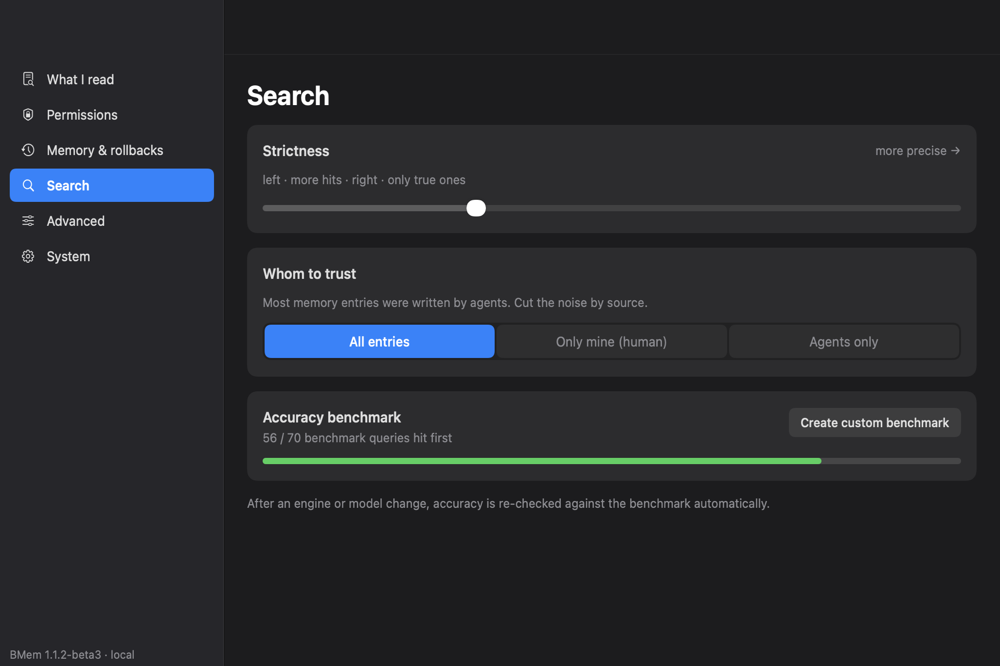
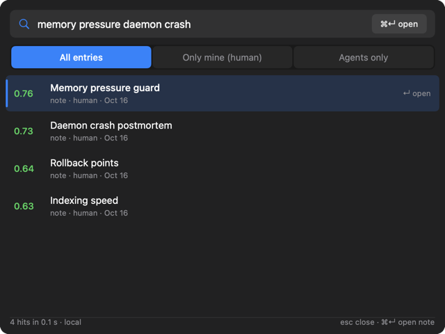
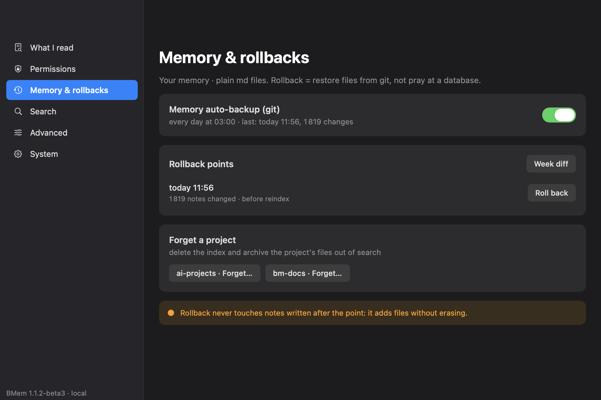

# BMem: Privacy-First AI Memory for Mac

**Native Swift app + MCP server. Your notes, your device, zero cloud.
Works with Claude, Hermes, OpenClaw. Install in 30 seconds.**

[](#when-not-to-use-bmem)


BMem is a memory provider for Hermes, Claude and OpenClaw — a native macOS
app + MCP server for semantic memory over your Markdown notes. A Basic
Memory alternative that runs entirely on your Mac: on-device embeddings on
the Neural Engine, a Spotlight-style hotkey search panel, and an
OpenAI-compatible embeddings endpoint. No Docker, Qdrant or Redis — one app.

> **⬇ [Download the latest release](https://github.com/RUSampson/basic-memory-native/releases/latest)**
> current build: [BMem-1.1.2-beta3.dmg](https://github.com/RUSampson/basic-memory-native/releases/download/1.1.2-beta3/BMem-1.1.2-beta3.dmg) (442 MB, model included) — requires macOS 27+ on Apple Silicon.

## Why BMem

- 🔒 **Privacy First** — no telemetry, no cloud, no external APIs. Your data
  never leaves your Mac. The telemetry toggle has no network code behind it at
  all: it is a no-op stub until signed builds exist.
- ⚡ **Native Performance** — the daemon idles at ~30 MB RSS / 77 MB footprint;
  model weights unload after 335 s idle and the embed worker exits after
  2×335 s. Warm searches answer in well under a second (p90 0.32 s on an
  11.1k-chunk corpus, measured 2026-10-19).
- 🎯 **Zero Setup** — the dmg ships the embedding model inside the app. No
  Python, no uv, no Docker, no API keys, no terminal.
- 🔄 **Seamless Migration** — same Markdown files as Basic Memory. Your
  existing Basic Memory config is picked up **automatically** on first launch
  (seeded from `~/.basic-memory/config.json`); switching your agent is one
  config line (`basic-memory` → `bmem mcp`), and back just as easily. No
  lock-in in either direction — Obsidian reads the same files.

## Quick start

```bash
# 1. Download the latest DMG (button above)
# 2. Open it, drag BMem.app to Applications
# 3. Launch BMem, pick your notes folder
# 4. Register BMem with your AI agent — for Claude Desktop
#    (claude_desktop_config.json):
{
  "mcpServers": {
    "bmem": {
      "command": "/Applications/BMem.app/Contents/MacOS/bmem",
      "args": ["mcp"]
    }
  }
}
# Done — your agent now has persistent memory.
```

> Use the full `/Applications/BMem.app/Contents/MacOS/bmem` path: Claude
> Desktop is a GUI process and does not inherit your shell `PATH`, so a bare
> `"bmem"` will not resolve. Your notes folder is chosen in the app window on
> first launch; power users can override it with the `BMEM_PROJECT_PATH`
> environment variable.

The same command works for every stdio MCP client — Hermes
(`mcp_servers` block in `config.yaml`), OpenClaw, Claude Code
(`claude mcp add bmem -- /Applications/BMem.app/Contents/MacOS/bmem mcp`),
Codex, Cursor, VS Code. Familiar tools stay — no skills or prompts to
rewrite. Verified on 1.1.2-beta3: the handshake above returns
14 tools (`search_notes`, `read_note`, `build_context`, …).

Measured on 2026-10-19: dmg mounted → app in /Applications → launched →
first search answered in **16 seconds** (reinstall over an existing index;
a first-ever launch additionally indexes your vault once).

## RAM that gives it back

The model lives in a child embed-worker that is killed when idle; the daemon
keeps serving keyword results meanwhile. Real run on the live daemon
(1.1.2-beta3, 11.3k chunks, 2026-10-19), footprint sampled every 15 s:

```
footprint MB   D = daemon   W = embed worker (model resident)
 400 │
 343 │
 286 │
 258 │                       WW WW WW WW WW WW WW WW WW W
 229 │               W WW WW
 200 │W WW WW W
 172 │         W WW W
 115 │D DD DD DD DD D
  86 │               D DD DD DD DD DD DD DD DD DD DD DD D
     └─────────────────────────────┼────────────────────────
      t=0 cold query 6.6s          335s idle → model unload
                                  (worker exits after 2×335 s idle)
```

After the worker exits the steady idle is **77 MB footprint / ~30 MB RSS**.
A cold query after unload costs ~6 s (worker respawn + model load; ~60 s once
after an OS update while the ANE shader cache rebuilds). Worker RSS looks
bigger (4–7 GB) because CoreML pages count compressed memory; footprint is
the honest number and is what the graph shows.

## Search quality (our own benchmark)

70 real RU/EN reference questions on a live personal-notes corpus
(11,147 chunks), frozen internal suite — **not an industry benchmark**.
Fresh A/B run on 1.1.2-beta3, 2026-10-19:

| Metric | Qwen3-Embedding-0.6B | EmbeddingGemma-2 (default) |
| --- | --- | --- |
| top-1 | 46/70 (65.7 %) | **56/70 (80.0 %)** |
| top-3 | 62/70 | **64/70** |
| top-1 RU / EN | 30/44 · 16/26 | **37/44 · 19/26** |
| search median | 348 ms | **270 ms** |
| search p90 | 559 ms | **324 ms** |
| idle footprint after unload | 182 MB | **89 MB** |

Method, caveats and the anonymized query set: [evals/BENCHMARKS.md](evals/BENCHMARKS.md).

## BMem vs the field

Star counts pulled from the GitHub API on 2026-10-19.

Direct alternatives (agent memory over your notes):

| Project | Stack | Stars | Notes |
| --- | --- | --- | --- |
| [basic-memory](https://github.com/basicmachines-co/basic-memory) | Python + uv | 4.3k | canonical note format — **BMem is file-compatible with it** and auto-imports its config |
| [mem0](https://github.com/mem0ai/mem0) | Python | 67k | memory-layer API/library, cloud-first with OSS tier |
| [mcp-memory-service](https://github.com/doobidoo/mcp-memory-service) | Python + ChromaDB | 2.0k | MCP server, needs a vector store |
| [OpenMemory MCP](https://github.com/mem0ai/mem0/tree/main/openmemory) | mem0 stack + Docker | — | local memory UI on the mem0 engine |
| [mcp-local-memory](https://github.com/Beledarian/mcp-local-memory) | TypeScript, SQLite FTS5 | 60 | keyword-first, optional sqlite-vec |

Adjacent (not file-based note memory): [Graphiti/Zep](https://github.com/getzep/graphiti) (32k), [Cognee](https://github.com/topoteretes/cognee) (32.5k), [Letta](https://github.com/letta-ai/letta) (25.2k) — enterprise agent-memory stacks; [Supermemory](https://github.com/supermemoryai/supermemory) (31.3k) — cloud API; [agentmemory](https://github.com/rohitg00/agentmemory) (29.7k) — coding-agent session capture daemon.

What none of them do in one native app:

- native Swift — no Python, no Docker, no Redis, no Qdrant, no ChromaDB;
- embeddings on the Apple Neural Engine via CoreML (not GPU, not a server);
- a Spotlight-style global hotkey panel for humans, not just agents;
- file compatibility with Basic Memory + automatic import of its config;
- an OpenAI-compatible `/v1/embeddings` endpoint on your Mac;
- LAN sharing of the same index behind an API key;
- parallel work with Obsidian on the same files.

## When NOT to use BMem

- **macOS 27+ only** — older macOS is not supported and won't be soon.
- **Apple Silicon only** — no Intel builds (the ANE path is the product).
- **It is agent memory, not knowledge management** — if you want a PKM/Zettelkasten
  suite for humans, that is Basic Memory's or Obsidian's job; BMem indexes the
  same files *for your AI agents*.

## Roadmap

The roadmap isn't published yet — but the
[issue tracker](https://github.com/RUSampson/basic-memory-native/issues) is.
Tell us what you're missing; it may well be the next thing we build.

## Models are not in the repo

The dmg contains EmbeddingGemma-2 inside the app bundle — nothing to download.
If you build from git, place the models manually into `~/.bmem/models/`:

- Default engine: [FluidInference/embeddinggemma-2-coreml](https://huggingface.co/FluidInference/embeddinggemma-2-coreml)
  (CoreML conversion of Google's EmbeddingGemma-2 weights, runs on the ANE)
- Fallback engine: [coreai-community/Qwen3-Embedding-0.6B-CoreAI](https://huggingface.co/coreai-community/Qwen3-Embedding-0.6B-CoreAI)
  (CoreAI conversion of Qwen's Qwen3-Embedding-0.6B weights)

## Screenshots

| Search | Hotkey panel | Memory & rollbacks |
| --- | --- | --- |
|  |  |  |

More (all English, shot on 1.1.2-beta3):
[first launch](design/screenshots/en/01-first-launch.png) ·
[what BMem reads](design/screenshots/en/02-what-i-read.png) ·
[permissions](design/screenshots/en/03-permissions.png) ·
[advanced](design/screenshots/en/06-advanced.png) ·
[system](design/screenshots/en/07-system.png) ·
[Russian set](design/screenshots/ru/)

## Credits / Related

- [Basic Memory](https://github.com/basicmachines-co/basic-memory) — the
  upstream ecosystem whose note format and MCP surface we are compatible
  with. We respect the upstream and chose AGPL deliberately. Also:
  [basicmemory.com](https://basicmemory.com)
- [FluidInference/embeddinggemma-2-coreml](https://huggingface.co/FluidInference/embeddinggemma-2-coreml)
  — default embedding engine (CoreML build; original weights by Google)
- [coreai-community/Qwen3-Embedding-0.6B-CoreAI](https://huggingface.co/coreai-community/Qwen3-Embedding-0.6B-CoreAI)
  — fallback engine (CoreAI build; original weights by Qwen)

## License

AGPL-3.0-only — see [LICENSE](LICENSE). Want to embed BMem in a commercial
product? AGPL obligations still apply — for a commercial license contact the
author: open an Issue or use the email in the [GitHub profile](https://github.com/RUSampson).

## Support

💛 **Want to support BMem?** We're not taking money through payment rails yet —
but if you'd like to sponsor development (or commercial licensing), open an
issue and we'll sort out the details.

[Русская версия →](README.ru.md)
