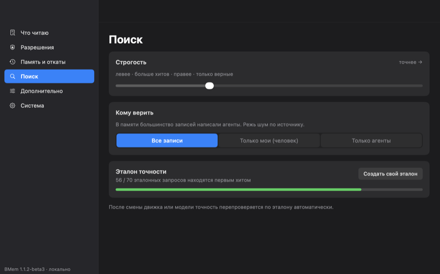
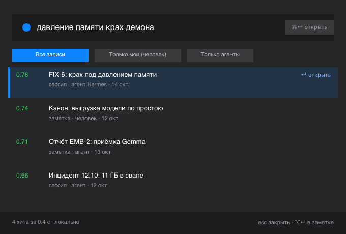
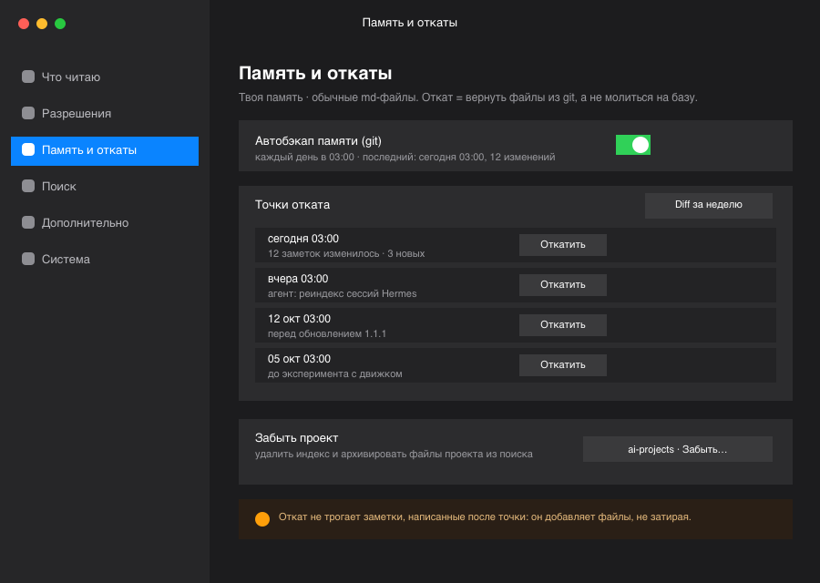

# BMem: приватная ИИ-память для Mac

**Нативное Swift-приложение + MCP-сервер. Ваши заметки, ваше устройство, ноль
облака. Работает с Claude, Hermes, OpenClaw. Установка за 30 секунд.**

[](#когда-bmem-не-подходит)


BMem — memory provider для Hermes, Claude и OpenClaw: приложение macOS +
MCP-сервер семантической памяти по вашим Markdown-заметкам. Basic Memory
alternative целиком на вашем Mac: эмбеддинги на Neural Engine, поиск в стиле
Spotlight по глобальному хоткею, OpenAI-совместимый эндпоинт эмбеддингов.
Без Docker, Qdrant и Redis — одно приложение.

> **⬇ [Скачать последний релиз](https://github.com/RUSampson/basic-memory-native/releases/latest)**
> текущая сборка: [BMem-1.1.2-beta3.dmg](https://github.com/RUSampson/basic-memory-native/releases/download/1.1.2-beta3/BMem-1.1.2-beta3.dmg) (442 МБ, модель внутри) — требует macOS 27+ на Apple Silicon.

## Почему BMem

- 🔒 **Приватность прежде всего** — никакой телеметрии, облака и внешних API.
  Данные не покидают ваш Mac. За переключателем телеметрии вообще нет
  сетевого кода: это заглушка до появления подписанных сборок.
- ⚡ **Нативная производительность** — демон в покое: ~30 МБ RSS / 77 МБ
  footprint; веса модели выгружаются после 335 с простоя, а embed-воркер
  завершается через 2×335 с. Тёплый поиск отвечает заметно быстрее секунды
  (p90 0,32 с на корпусе 11,1k чанков, замер 19.10.2026).
- 🎯 **Нулевая настройка** — модель эмбеддингов лежит внутри dmg. Никаких
  Python, uv, Docker, API-ключей и терминала.
- 🔄 **Бесшовный переезд** — те же Markdown-файлы, что у Basic Memory. Конфиг
  Basic Memory подхватывается **автоматически** при первом запуске (посев из
  `~/.basic-memory/config.json`); переключение агента — одна строка конфига
  (`basic-memory` → `bmem mcp`), обратно — так же. Lock-in нет ни в одну
  сторону, Obsidian читает те же файлы.

## Быстрый старт

```bash
# 1. Скачайте последний DMG (кнопка выше)
# 2. Откройте, перетащите BMem.app в Программы
# 3. Запустите BMem, выберите папку с заметками
# 4. Подключите BMem к вашему ИИ-агенту — для Claude Desktop
#    (claude_desktop_config.json):
{
  "mcpServers": {
    "bmem": {
      "command": "/Applications/BMem.app/Contents/MacOS/bmem",
      "args": ["mcp"]
    }
  }
}
# Готово — у вашего агента теперь постоянная память.
```

> Используйте полный путь `/Applications/BMem.app/Contents/MacOS/bmem`:
> Claude Desktop — GUI-процесс, он не наследует ваш shell-`PATH`, и голое
> `"bmem"` не найдётся. Папка заметок выбирается в окне приложения при первом
> запуске; для опытных — переопределение через переменную окружения
> `BMEM_PROJECT_PATH`.

Та же команда работает с любым stdio MCP-клиентом — Hermes (блок
`mcp_servers` в `config.yaml`), OpenClaw, Claude Code
(`claude mcp add bmem -- /Applications/BMem.app/Contents/MacOS/bmem mcp`),
Codex, Cursor, VS Code. Знакомые инструменты остаются — скиллы и промпты
переписывать не нужно. Проверено на 1.1.2-beta3: рукопожатие выше возвращает
14 инструментов (`search_notes`, `read_note`, `build_context`, …).

Замер 19.10.2026: от монтирования dmg до первого ответа поиска —
**16 секунд** (перехстановка поверх готового индекса; при первом в жизни
запуске добавится разовое индексирование хранилища).

## Память, которая возвращается

Модель живёт в дочернем embed-воркере и убивается по простою; демон всё это
время отдаёт ключевые результаты. Реальный прогон на живом демоне
(1.1.2-beta3, 11,3k чанков, 19.10.2026), footprint каждые 15 с:

```
footprint МБ   D = демон   W = embed-воркер (модель в памяти)
 400 │
 343 │
 286 │
 258 │                       WW WW WW WW WW WW WW WW WW W
 229 │               W WW WW
 200 │W WW WW W
 172 │         W WW W
 115 │D DD DD DD DD D
  86 │               D DD DD DD DD DD DD DD DD DD DD DD D
     └─────────────────────────────┼────────────────────────
      t=0 холодный запрос 6,6с     335 с простоя → выгрузка модели
                                  (воркер завершится через 2×335 с)
```

После завершения воркера устойчивый покой — **77 МБ footprint / ~30 МБ RSS**.
Холодный запрос после выгрузки стоит ~6 с (респавн воркера + загрузка модели;
~60 с один раз после обновления ОС, пока пересобирается кэш шейдеров ANE).
RSS воркера выглядит больше (4–7 ГБ), потому что страницы CoreML считаются со
сжатой памятью; честная метрика — footprint, он на графике.

## Качество поиска (наш собственный бенч)

70 реальных RU/EN эталонных вопросов по живому корпусу личных заметок
(11 147 чанков), замороженная внутренняя выборка — **не индустриальный
бенчмарк**. Свежий A/B-прогон на 1.1.2-beta3, 19.10.2026:

| Метрика | Qwen3-Embedding-0.6B | EmbeddingGemma-2 (дефолт) |
| --- | --- | --- |
| top-1 | 46/70 (65,7 %) | **56/70 (80,0 %)** |
| top-3 | 62/70 | **64/70** |
| top-1 RU / EN | 30/44 · 16/26 | **37/44 · 19/26** |
| медиана поиска | 348 мс | **270 мс** |
| p90 поиска | 559 мс | **324 мс** |
| footprint в покое после выгрузки | 182 МБ | **89 МБ** |

Методика, оговорки и обезличенный набор запросов: [evals/BENCHMARKS.md](evals/BENCHMARKS.md).

## BMem на фоне остальных

Звёзды сняты с GitHub API 19.10.2026.

Прямые альтернативы (память агента поверх ваших заметок):

| Проект | Стек | Звёзды | Комментарий |
| --- | --- | --- | --- |
| [basic-memory](https://github.com/basicmachines-co/basic-memory) | Python + uv | 4,3k | канонический формат заметок — **BMem файлово совместим** и автоматически импортирует его конфиг |
| [mem0](https://github.com/mem0ai/mem0) | Python | 67k | memory-layer API/библиотека, cloud-first с OSS-слоем |
| [mcp-memory-service](https://github.com/doobidoo/mcp-memory-service) | Python + ChromaDB | 2,0k | MCP-сервер, нужен векторный стор |
| [OpenMemory MCP](https://github.com/mem0ai/mem0/tree/main/openmemory) | стек mem0 + Docker | — | локальный UI памяти на движке mem0 |
| [mcp-local-memory](https://github.com/Beledarian/mcp-local-memory) | TypeScript, SQLite FTS5 | 60 | ключевой поиск, опционально sqlite-vec |

Смежные (не файловая память заметок): [Graphiti/Zep](https://github.com/getzep/graphiti) (32k), [Cognee](https://github.com/topoteretes/cognee) (32,5k), [Letta](https://github.com/letta-ai/letta) (25,2k) — энтерпрайз-стеки памяти агентов; [Supermemory](https://github.com/supermemoryai/supermemory) (31,3k) — облачный API; [agentmemory](https://github.com/rohitg00/agentmemory) (29,7k) — демон сессий кодинг-агентов.

Чего не делает никто из них в одном нативном приложении:

- нативный Swift — никаких Python, Docker, Redis, Qdrant, ChromaDB;
- эмбеддинги на Neural Engine через CoreML (не GPU и не сервер);
- глобальная хоткей-панель в стиле Spotlight — для людей, не только для агентов;
- файловая совместимость с Basic Memory + автоматический импорт его конфига;
- OpenAI-совместимый `/v1/embeddings` прямо на вашем Маке;
- LAN-шаринг того же индекса по API-ключу;
- параллельная работа Obsidian с теми же файлами.

## Когда BMem не подходит

- **Только macOS 27+** — старые версии не поддерживаются и в ближайшее время не будут.
- **Только Apple Silicon** — сборок под Intel нет (путь через ANE и есть продукт).
- **Это память для агентов, а не knowledge management** — если нужен
  Zettelkasten/PKM-комбайн для человека, это задачи Basic Memory и Obsidian;
  BMem индексирует те же файлы *для ваших ИИ-агентов*.

## Дорожная карта

Дорожная карта пока не опубликована — зато
[issues](https://github.com/RUSampson/basic-memory-native/issues) уже
принимаются. Расскажи, чего не хватает — возможно, следующим пунктом станет
именно это.

## Моделей нет в репозитории

В dmg модель EmbeddingGemma-2 лежит внутри приложения — качать нечего. При
сборке из git разложите модели вручную в `~/.bmem/models/`:

- Движок по умолчанию: [FluidInference/embeddinggemma-2-coreml](https://huggingface.co/FluidInference/embeddinggemma-2-coreml)
  (CoreML-конверсия оригинальных весов Google EmbeddingGemma-2, ANE)
- Fallback-движок: [coreai-community/Qwen3-Embedding-0.6B-CoreAI](https://huggingface.co/coreai-community/Qwen3-Embedding-0.6B-CoreAI)
  (CoreAI-конверсия оригинальных весов Qwen Qwen3-Embedding-0.6B)

## Скриншоты

| Поиск | Хоткей-панель | Память и откаты |
| --- | --- | --- |
|  |  |  |

Ещё (русский набор): [первый запуск](design/screenshots/ru/01-first-launch.png) ·
[что читает BMem](design/screenshots/ru/02-what-i-read.png) ·
[разрешения](design/screenshots/ru/03-permissions.png) ·
[дополнительно](design/screenshots/ru/06-advanced.png) ·
[система](design/screenshots/ru/07-system.png) ·
[английский набор](design/screenshots/en/)

## Credits / Related

- [Basic Memory](https://github.com/basicmachines-co/basic-memory) —
  апстрим-экосистема, с форматом заметок и MCP-поверхностью которой мы
  совместимы. Апстрим уважаем и AGPL выбрали осознанно. Также:
  [basicmemory.com](https://basicmemory.com)
- [FluidInference/embeddinggemma-2-coreml](https://huggingface.co/FluidInference/embeddinggemma-2-coreml)
  — движок эмбеддингов по умолчанию (CoreML-сборка; оригинальные веса — Google)
- [coreai-community/Qwen3-Embedding-0.6B-CoreAI](https://huggingface.co/coreai-community/Qwen3-Embedding-0.6B-CoreAI)
  — fallback-движок (CoreAI-сборка; оригинальные веса — Qwen)

## Лицензия

AGPL-3.0-only — см. [LICENSE](LICENSE). Хотите встроить BMem в коммерческий
продукт? Обязательства AGPL сохраняются — за коммерческой лицензией
свяжитесь с автором: откройте Issue или используйте почту из
[GitHub-профиля](https://github.com/RUSampson).

## Поддержать

💛 **Хотите поддержать BMem?** Платёжные каналы мы пока не подключили — но
если хотите спонсировать разработку (или коммерческую лицензию), откройте
issue, и мы обо всём договоримся.

[English version →](README.md)
